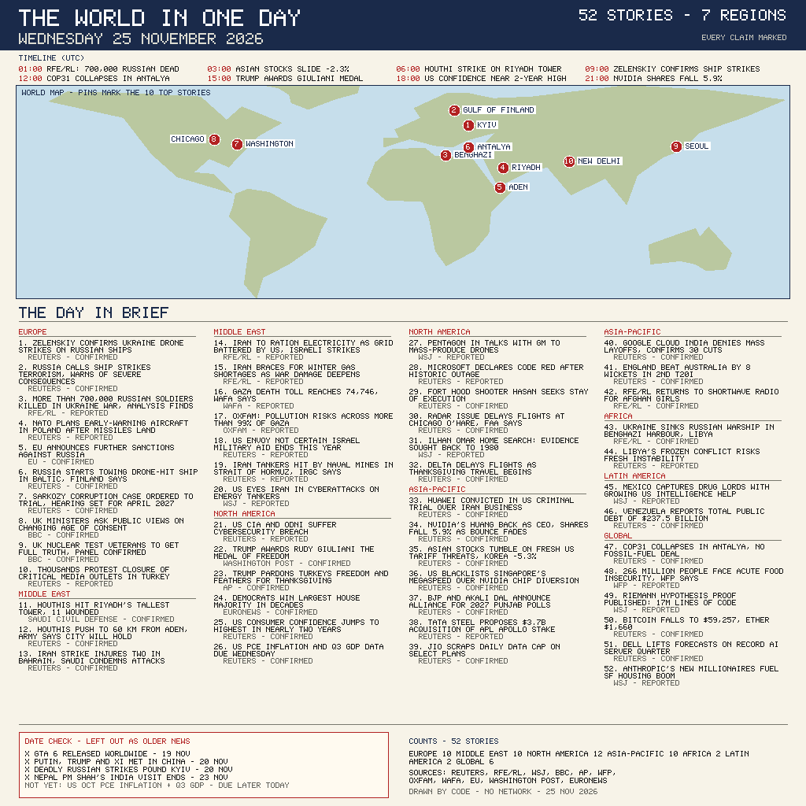

[](https://make.fun/c/news-image-20261125)
[](https://make.fun/c/news-image-20261125)
[](https://make.fun/c/news-image-20261125)

# The World in One Day — Wednesday 25 November 2026

A one-day world newspaper drawn entirely by code: **52 sourced stories, 7 regions,
10 numbered pins on a world map, a UTC timeline, and a DATE CHECK box** that names
the older news deliberately left out. Every claim is marked CONFIRMED or REPORTED
with its source.



## How it runs

Pure Python 3 standard library, no network, fully deterministic:

```sh
mkdir -p out && MAKEFUN_OUTPUT_DIR=out python3 main.py
```

Two runs write byte-identical `entry.png` (1024x1024, 42 KB).

## What is inside

- **Masthead** — "THE WORLD IN ONE DAY", Wednesday 25 November 2026.
- **Timeline (UTC)** — 8 events in the order they were reported.
- **World map** — coarse continent outlines with 10 numbered pins placed by
  longitude/latitude: Kyiv, Gulf of Finland, Benghazi, Riyadh, Aden, Antalya,
  Washington, Chicago, Seoul, New Delhi.
- **The day in brief** — 52 stories: Europe 10, Middle East 10, North America 12,
  Asia-Pacific 10, Africa 2, Latin America 2, Global 6. Each story carries its
  source and a CONFIRMED/REPORTED mark.
- **DATE CHECK** — older news left out on purpose: GTA 6 release (19 Nov),
  Putin/Trump/Xi in China (20 Nov), deadly Russian strikes on Kyiv (20 Nov),
  Nepal PM's India visit ending (23 Nov). Plus the US Oct PCE and Q3 GDP data,
  due after press time.

## Sources

Reuters, RFE/RL, Wall Street Journal, BBC, AP, WFP, Oxfam, WAFA, EU,
Washington Post, Euronews. Headlines are the day's own reporting; nothing is
presented as fact that was only reported as a claim.
